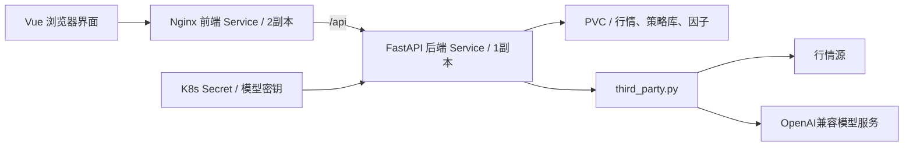

# Vue / Python 分离与 Kubernetes 部署

## 检查结论

原有结构已是 Vue 3 + TypeScript 前端、Python FastAPI 后端，通过 `/api` 通信；后端不负责渲染页面，前端也不直接访问行情SDK或模型密钥。原先仅有开发启动脚本，数据目录固定在仓库内，没有独立生产镜像、卷、探针及K8s清单。

本次补齐两份独立镜像、Nginx同源反向代理、运行时环境变量、非root运行、只读根文件系统、持久卷、资源限制和健康探针。`frontend/`、`backend/`可分别构建与发布，镜像不会携带本地样例数据或`.env`。



**当前是可在K8s运行的单后端持久化方案，不是多副本高可用后端。** JSON/Parquet、`fcntl`锁及进程内采集任务决定了后端保持一个副本、一个Uvicorn worker，使用`Recreate`更新策略和RWO卷；前端是无状态的，可独立扩容。不要只提高后端replicas或挂载共享盘就宣称完成横向扩容。下一阶段若需要后端多副本，应将策略/元数据迁移数据库、行情迁移对象存储，并使用外部队列/Worker承接采集任务。

## 构建与验收

在仓库根目录执行：

```bash
docker build -f backend/Dockerfile -t myquant-backend:verify .
docker build -f frontend/Dockerfile -t myquant-frontend:verify .
python3 scripts/verify_containers.py
```

脚本在独立Docker网络运行真实镜像，验证非root/只读根目录、页面和`/strategies`历史路由、`/api`代理、探针、策略/因子写入及后端容器重建后的卷持久化，结束后清理测试容器、网络和卷。只使用合成数据，不调用实盘或真实模型。

受企业代理CA影响时，可传 `--secret id=proxy_ca,src=/path/to/ca-bundle.pem`；证书只在构建步骤挂载，不进入镜像。不关闭TLS校验。

## 部署到已有集群

1. 将两个镜像推入你的镜像仓库，在 `deploy/k8s/kustomization.yaml` 设置真实镜像地址与提交版本标签；私有仓库按集群要求配置imagePullSecrets。
2. `deploy/k8s/storage.yaml`默认申请20Gi RWO卷，使用集群默认StorageClass；没有默认存储类时需补充`storageClassName`。
3. 执行：

```bash
kubectl kustomize deploy/k8s
kubectl apply -k deploy/k8s
kubectl -n myquant rollout status deployment/myquant-backend
kubectl -n myquant rollout status deployment/myquant-frontend
kubectl -n myquant port-forward service/myquant-frontend 8088:80
```

打开 `http://localhost:8088`。默认仅创建ClusterIP Service；如需公网访问，在你的Ingress/API网关层配置域名、TLS和身份验证后接入前端Service。当前应用本身没有账户认证，不默认创建公开入口。

`deploy/k8s/config.yaml`管理非敏感运行配置：

| 变量 | 用途 |
| --- | --- |
| `QUANT_DATA_DIR` | 数据卷路径，镜像默认为`/var/lib/myquant` |
| `QUANT_CORS_ORIGINS` | 逗号分隔；生产同源代理使用空串，本地默认允许5173开发页面 |
| `LLM_BASE_URL` | OpenAI兼容服务基础地址，通常以`/v1`结尾，不填写`/chat/completions` |
| `LLM_MODEL` | 实际模型ID |
| `LLM_API_KEY` | 由`myquant-llm` Secret的`api-key`键注入，只给后端 |

模型配置可后补；缺少配置时，手动策略编辑/保存/回测仍可用，Agent按钮明确禁用。密钥可通过集群密钥管理或本地私密文件创建，例如`kubectl -n myquant create secret generic myquant-llm --from-file=api-key=/path/to/private-key.txt`。更新配置后执行`kubectl -n myquant rollout restart deployment/myquant-backend`。不要把密钥写进前端、ConfigMap或Git。

前端通过运行时`API_UPSTREAM`选择后端上游，默认`myquant-backend:8080`；无需因更换后端地址而重新编译Vue。后端`/api/health/live`检查进程，`/api/health/ready`检查数据卷可写；不把外部行情/模型短时故障当作Pod死亡。

## 运维边界与验证范围

- 任务在后端进程内运行，Pod重建会中止正在采集的任务；原子缓存和成功个股文件可保留，下次点击继续采集。滚动更新前安排采集窗口；本方案有单后端更新停机时间。
- PVC持久化不等于备份，使用集群存储快照/备份策略保护个人数据。默认文件布局保留既有行情口径和复权隔离规则。
- 外部市场域名及模型服务需由集群网络策略允许。所有外部调用和接口配置仍集中在`backend/app/data/third_party.py`。
- 已提供真实镜像联调与K8s schema校验；本次没有接入你的K8s集群，未执行云上部署或宣称集群验收。当前云环境行情源仍有403限制，用户尚未配置真实模型服务。
